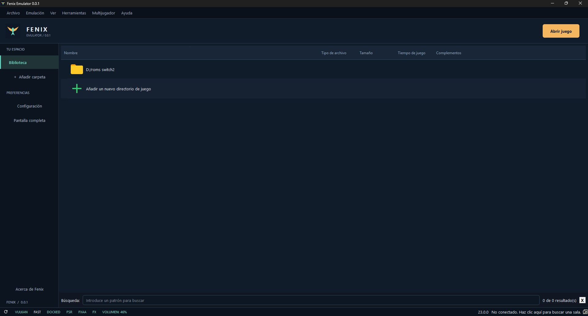

# Fenix Emulator

**Versión 0.0.1 · Proyecto de FenixPoderoso · Windows x64**

Una interfaz propia para organizar y ejecutar tu biblioteca, con diseño oscuro, acentos ámbar y turquesa, y configuración de video, audio y controles familiar.

## Descargas y código fuente

[Versión experimental v0.0.1 y paquetes verificados](https://github.com/FenixPoderoso/fenix-emulator/releases/tag/v0.0.1). El árbol completo del código está disponible en este repositorio, con las carpetas `src`, `externals`, `dist`, `docs` y `scripts`.

La etiqueta v0.0.1 conserva la publicación inicial de documentación; para reproducir exactamente aquella entrega también está el adjunto `Fenix-Emulator-0.0.1-source.zip`. No se ha reescrito la etiqueta ni sustituido sus binarios.

## Estado

Proyecto experimental. La versión 0.0.1 cambia la interfaz sobre una base de emulación existente y conserva el parche gráfico local HSETP2. Bananza sigue mostrando terreno negro en ciertas zonas. Este cambio visual no supone mejoras de rendimiento ni compatibilidad completa.

## Usar la versión portable

1. Extraer el paquete completo en una carpeta.
2. Abrir `fenix.exe` junto a sus DLL y plugins.
3. Usar **Abrir juego** o los menús de carga de archivo/carpeta.
4. Entrar en **Configuración** para ajustar video, audio y controles.

La carpeta `user/` contiene los datos locales de la instalación portable. Conserva tus respaldos antes de trasladar datos. Una distribución pública no incluye claves, firmware, juegos ni partidas.

La detección automática de respaldos extraídos y la elección de su `main` siguen pendientes. **Añadir carpeta** conserva la detección de la base; no se presenta como la nueva función solicitada.

## Documentación

- [Compilar y empaquetar](docs/FENIX_BUILD.md)
- [Avances y procedencia técnica](docs/FENIX_HISTORY.md)
- [Cambios de la versión](CHANGELOG.md)
- [Preparar la publicación en GitHub](docs/PUBLICAR_EN_GITHUB.md)
- [Licencias y atribuciones](NOTICE.md)
- [Validación de esta entrega](docs/VALIDATION.md)

## Código y licencia

Fenix Emulator deriva de Eden-NS2, Eden y yuzu. Se conservan los copyrights y las licencias de sus autores. El motor y sus identificadores internos proceden de esa base; FenixPoderoso identifica este proyecto y su nueva presentación.

Consultar [LICENSE.txt](LICENSE.txt), [LICENSES](LICENSES/) y los avisos SPDX por archivo. Los cambios Fenix se ofrecen bajo GPL-3.0-or-later. Se utilizó Codex para preparar la interfaz y documentación; la revisión y publicación son responsabilidad del autor humano.

Nintendo Switch es una marca de Nintendo. Proyecto independiente sin afiliación con Nintendo ni con los proyectos originales.
